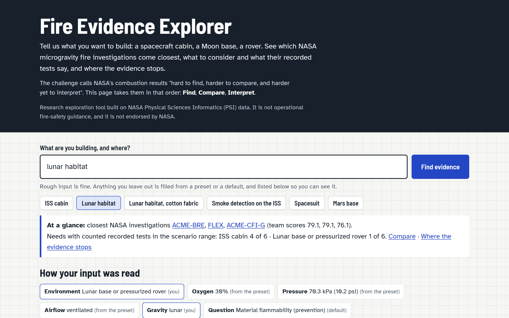

# Fire Evidence Explorer (NASA_RAPID)

Fire Evidence Explorer is a web page: you describe a crewed environment, and it shows which of NASA's microgravity fire investigations come closest, what their recorded tests can say about six fire-safety information needs, and where the evidence stops.

**Live page:** https://choidol0208.github.io/NASA_RAPID/

**Demo links:** [ISS cabin](https://choidol0208.github.io/NASA_RAPID/?q=ISS) · [Lunar habitat](https://choidol0208.github.io/NASA_RAPID/?q=lunar%20habitat)

**Start here:** open the Lunar habitat demo, then the sections "ISS and lunar habitat, side by side" and "Where the evidence stops". For the lunar habitat (30% oxygen or more and at or below 70.3 kPa), PSI has no counted test.

Built during the 2026 NASA Space Apps Challenge (Seoul, 14–15 November 2026) for the challenge *Flame in Freefall: SI-Powered Fire Safety Insights from Microgravity Combustion Data*. The data is NASA's Physical Sciences Informatics (PSI) archive: 24 combustion investigations.

It is a research exploration tool. It is not operational fire-safety guidance, and it is not endorsed by NASA. Scores, rankings and counts are the team's computation, not NASA's conclusions. Nothing on the page predicts what happens under conditions that were not tested.

*Most of this repository was written with an AI assistant (Claude Code). Each generated file says so at the top. `compliance/AI_USAGE_LOG.md` lists every use; see "How AI was used" below.*

## Screenshots

The images are screenshots of the page, taken with `web/capture_media.mjs`. Their numbers match the page built from this repository at the 19:00 freeze on 14 November.

The lunar habitat query: how the input was read, and the closest investigations.



The ISS cabin and the lunar habitat side by side: counted recorded tests per need.


Where the evidence stops: every recorded test on the oxygen axis, by kind of fuel, with the input at 30% oxygen.


A short animation, from the ISS query to the lunar habitat query: [`web/media/demo_iss_to_lunar.gif`](web/media/demo_iss_to_lunar.gif) (2.4 MB).

## What you can do on the page

1. Type what you are building and where, for example "ISS" or "lunar habitat cotton fabric", or press one of six presets. Every value you left out is filled in and shown with where it came from.
2. See the three closest of the 24 PSI investigations, with the team's score, the match on each dimension, the largest gap, and links to the PSI page, the dataset DOI and the source table.
3. For six fire-safety information needs (prevention, detection, suppression), see whether the recorded tests hold the conditions and the outcome the need asks for. Click a cell to see the pipeline row behind it.
4. Compare the ISS cabin with the lunar habitat, and see where the recorded tests stop on the oxygen and pressure axes.
5. Download the matched tests (CSV) and the evidence package (JSON), and share a query as a link (`?q=...`).

## What is implemented today

Checked against the page built from this repository at the freeze (`python3 web/build.py`, served locally, page read with headless Chrome for `?q=ISS` and `?q=lunar%20habitat`).

- A query box with six presets: ISS cabin, Lunar habitat, Lunar habitat cotton fabric, Smoke detection on the ISS, Spacesuit, Mars base. `?q=` opens the page with a query.
- "How your input was read": each value, marked as typed by you, taken from a preset, or a default.
- "Closest NASA investigations": the top three with the team's score (0–100), similarity per dimension, the reason, the largest gap, a confidence label, and source links. Each result also summarises PSI's file listing for that investigation. For the ISS, lunar habitat, spacesuit and Mars base queries, each result shows how stable its rank is when the team's weights are varied.
- "What to consider, and what the recorded tests say": six needs against the ranked investigations, one status per cell from the data pipeline, and the ISS cabin and the lunar habitat side by side.
- "Recorded tests in the scenario range", "What is known, need by need" (fixed sentences built by code, no language model), "What NASA's recorded tests showed" and "Criteria in NASA documents".
- "Where the evidence stops": recorded tests on the oxygen axis by kind of fuel, a grid of recorded tests by oxygen and pressure, and what PSI does not contain for the chosen environment.
- "All 24 investigations for this input": the full ranking.
- Downloads: the matched tests (CSV), the evidence package (JSON), all recorded tests (CSV).
- "How AI is used here, and how it was checked": the counts for the model-written sentences, a diagnostic of whether the NASA tables could support an outcome model, and the sensitivity of the ranking to the team's weights.
- The video side pilot appears as a note on the BASS-II result.

The page is static. No language model runs in it, and it needs no server, account or API key.

## How it is built

The team worked in four Claude Code sessions, one per role: pm, data, ui and catalog. Each part below names its folder and its role.

**Data pipeline** (`pipeline/`, outputs in `data/pipeline/`; data role). The data role's AI session (Claude Code), directed by the team, drafted six fire-safety questions from 66 published documents (`pipeline/spec/references.json`), each with the variables a test must record. The pipeline maps the 22 PSI experimental tables to standard variables, giving 1,824 test rows. It links a test to a need only when the investigation states that need as an objective. `pipeline/check.py` recomputes every output with separate code. Details: `pipeline/README.md`.

**Ranking** (`scoring/`, `validation/`, `data/catalog/`; catalog role). A catalog of the 24 investigations and their 41 test configurations, extracted from the PSI records and tables by an AI assistant. A rule-based scorer compares the input with each configuration on up to seven dimensions (oxygen, pressure, flow, fuel, sample shape, research purpose, diluent gas), with weights that depend on the kind of question. Code computes every score; a language model never produces or changes one. The page runs a JavaScript port of the same scorer, and a check confirms that both give the same results. Method: `scoring/METHOD.md`.

**AI layer** (`ai/`, outputs in `data/insights/`; pm role). Code builds the scenario text, the gaps, the counts, the quotes and the evidence map from the PSI files and the pipeline outputs. One local language model wrote short summary sentences for the investigation cards before publishing; code gates checked each sentence. Details: the section "AI layer" below.

**Page** (`web/`; ui role). Plain HTML, CSS and JavaScript. `web/build.py` copies the page and the data files it reads into `web/dist/`. A GitHub Actions workflow (`.github/workflows/pages.yml`) runs the ranking unit tests, the validation scenarios, the integration check and the JavaScript/Python parity check, builds the page and deploys it to GitHub Pages. The AI-layer, pipeline and video checks are run by hand (see "How to run it"). Details: `web/README.md`.

**Video side pilot** (`video/`; pm role). For 19 BASS-II clips (PSI-25), a reader copies the numbers NASA's video shows on screen (FUEL, AIR, FAN, RAD and a clock) into one row per second. It is a transcription of NASA's display, not a NASA data file and not a measurement. Output: `video/data/team_transcription_bass2_onscreen_readings/`. Details: `video/README.md`.

## How to run it

Needs Python 3 (tried with 3.13.5). The page build, the scorer and the pipeline check use only the Python standard library. Other needs are named at each step. The results below were measured on 14 November 2026, after the 19:00 freeze.

### Build and open the page

```
python3 web/build.py
cd web/dist && python3 -m http.server 8000
```

Then open http://localhost:8000/?q=lunar%20habitat. The build printed `built 44 files`.

### Pipeline checks

```
python3 pipeline/check.py
```

This recomputes every output in `data/pipeline/` from the raw tables and the spec files, and rewrites `data/pipeline/validation_report.json`. To leave the repository unchanged, check a copy:

```
cp -R data/pipeline /tmp/pipeline_copy
python3 pipeline/check.py --data /tmp/pipeline_copy
```

Result: `59 checks: 57 PASS, 0 FAIL, 2 SKIP`. The two skipped checks recount the raw-data inventory, which needs `data/psi/file_listings/`. That folder is not in the repository. `python3 pipeline/raw_inventory.py --refresh` fetches the listings from PSI.

To rebuild the pipeline outputs (needs pandas; this downloads from PSI and rewrites `data/psi/` and `data/pipeline/`; not run for this README):

```
python3 scripts/fetch_psi.py
python3 pipeline/run.py
```

### Ranking tests

```
python3 -m scoring.scorer "lunar habitat"
python3 -m unittest scoring.test_scorer
python3 web/parity_check.py
python3 web/check_integration.py
```

Results: the scorer printed ACME-BRE, FLEX and ACME-CFI-G as the top three; `Ran 39 tests ... OK`; `parity: 99/99 queries identical` (needs Node.js 18 or later; tried with v25.2.1); `11 queries, 33 results checked, 0 broken joins`.

The scenario, stability and sensitivity checks rewrite `validation/report.md` (not run for this README):

```
python3 validation/run_validation.py
```

### AI layer build and tests

```
python3 -m unittest discover -s ai -p "test_*.py"
python3 ai/check_all.py
```

Result of the tests: `Ran 241 tests ... OK`. No test calls a model. `ai/check_all.py` only reads; it checks everything in `data/insights/`.

Result of `ai/check_all.py` (14 November 2026, after the English compliance logs were committed): `PASS: 0 hard failure(s); 0 file(s) not built yet; 0 report-only lint hit(s)`.

The build rewrites every file in `data/insights/`, with no model call (needs NumPy, pandas and scikit-learn; not run for this README):

```
python3 ai/build_all.py
```

### Video reader tests

```
python3 video/test_read_overlay.py
python3 video/read_overlay.py --settings video/settings/bass2.json --list
```

Results: `Ran 9 tests ... OK` (needs NumPy and Pillow); `--list` printed the 19 clips. The tests run without the videos.

Reading the clips needs the 19 mp4 files from PSI, which are not in the repository, and `ffmpeg` and `ffprobe` (not run for this README):

```
python3 video/read_overlay.py --settings video/settings/bass2.json --clips <folder with the mp4 files> --out <folder>
```

## Data and licence

Data: NASA PSI Data Repository, https://psi.nasa.gov/ (records are CC0-1.0 where a license is stated; see `compliance/SOURCES.md`). PSI asks that each investigation be cited by its DOI; the DOIs are in `data/psi/manifest.json`.

The repository holds what the page needs: the 24 PSI records, the 22 experimental tables and the manifest in `data/psi/`. The BASS-II video clips are not in the repository. Fonts, libraries and documents used are listed with their licences in `compliance/SOURCES.md`.

## How AI was used

- Code, documents and data processing were written with Claude Code (Anthropic) in four working sessions, one per team role, under the team's direction. Each generated file says so at the top.
- In the product, one local model, OpenAI gpt-oss:20b (Apache-2.0, run through Ollama), wrote short summary sentences for the investigation cards before publishing. The page never calls a model. No number, score or count comes from a model.
- Code gates checked every model sentence; a second AI session then read them. Of 70 sentences, 33 are shown, each labelled "AI-generated" with the NASA sentences it rests on. Reviewed by a second AI session: 61. Reviewed by a person: 0.
- The full record is `compliance/AI_USAGE_LOG.md`. On the page, the block "How AI is used here, and how it was checked" shows the counts (`data/insights/quality.json`).

## Known limits

Data and pipeline (from `pipeline/README.md`):

- Only the PSI experimental tables are mapped. Publications, analysed data and raw data are not. Eight mapped tables are not test-level (for example, one row per test day).
- A "test" is one row of a NASA table.
- The six needs are the team's construction (an AI draft) from published documents, not a NASA list or standard. Five of the six are limited to solid fuels.
- 408 of the 1,824 test rows count for at least one need. They come from four investigations (PSI-25, 69, 98, 99).
- Ignition and smoke particle size have no counted test: no mapped column holds those outcomes.
- The BASS-II and Saffire tables have no pressure column. Pressure is documented for each investigation as a whole (about 1 atm), not for each test.
- The Saffire oxygen value is what the ISS reported about one day before the tests, not a reading at ignition.
- The ISS ranges are the team's bins, not an ISS operating range.
- Lunar habitat: the 17 counted tests in its oxygen range are FLEX droplet tests recorded at 71.2 to 72.4 kPa, 1 to 2 kPa above 70.3 kPa (10.2 psi). No counted test was recorded at 30% oxygen or more and at or below 70.3 kPa.
- Every test in the PSI tables used here was run in microgravity. Results at 0 g and 1 g are not bounds for lunar or Martian gravity.

Ranking (from `scoring/PARAMETER_REVIEW.md`):

- The weights and scales are the team's choices. A combustion textbook (Turns 2012) supports the direction of several rules, not their sizes.
- Each value was halved and raised by half on four demo queries. Of 136 runs, 129 keep the same top three in the same order, 3 keep the same three in another order, and rank 1 changes in 3.
- The two demo queries (ISS, lunar habitat) do not change. All changes come from the two cotton-fabric queries (ISS cotton fabric, and the preset Lunar habitat cotton fabric) and from two values: how steeply oxygen above a test's maximum is penalised, and the fuel similarity table.
- A configuration whose record gives no atmosphere is scored at an assumed 21% oxygen and 101.3 kPa. It can outscore a recorded near match; the page labels it with medium confidence.
- Within 3 points, stronger evidence goes first. At low scores, 3 points is a large share.
- Catalog values were extracted from the PSI records by an AI assistant and are labelled "AI-extracted" on the page.

Video side pilot (from `video/README.md`):

- 19 BASS-II clips only; nothing is said about the other 277 clips of PSI-25. Not tried on any other experiment.
- An AI assistant compared 186 frames (about 750 values) with the picture and found none wrong. From the random frames alone, fewer than about 1 value in 100 should be wrong.
- It gives no flame-out time, ignition time, burn duration, or flow speed at blowoff or extinction. An automatic flame signal from picture brightness failed its check and was removed.
- RAD is an uncalibrated reading, not a heat flux. AIR 0 does not mean still air. A flow speed derived from FAN is a calibration estimate, off by about 30% where it could be tested.
- The download path of `--fetch` has not been run. A watcher for new PSI data is a design only.

## What is next

- Review by combustion researchers: the eight questions at the end of `scoring/PARAMETER_REVIEW.md`, and the six needs in `pipeline/spec/needs.json`.
- Compare the catalog values behind the demo rankings with the NASA rows listed in `validation/verification_sheet.csv`.
- Map the per-sample pressure column of the Saffire raw data in PSI, which the pipeline does not read yet.
- Add test-level records from combustion tests at lunar gravity when such records exist in PSI.

## Repository map

| Path | Content | Role |
|---|---|---|
| `web/` | The page, its build, the scorer's JavaScript port and the checks. `web/media/` holds the screenshots | ui (scorer port: catalog) |
| `pipeline/` | Spec-driven pipeline from the PSI tables to standard variables and fire-safety information needs | data |
| `data/psi/` | PSI records and experimental tables as downloaded, and the manifest with the DOIs | data |
| `data/pipeline/` | Pipeline outputs: one row per test, capability matrix, tests per need, evidence packages | data |
| `data/catalog/` | Catalog of the 24 investigations and 41 test configurations | catalog |
| `scoring/`, `validation/` | Rule-based ranking, its method, and its test scenarios and sensitivity checks | catalog |
| `ai/`, `data/insights/` | AI layer: code-built text, card summaries, evidence map, diagnostics | pm |
| `video/` | Video side pilot: on-screen readings of 19 BASS-II clips | pm |
| `docs/submission/` | Drafts of the submission text and the slide outline | pm |
| `compliance/` | `SOURCES.md` (every source and licence) and `AI_USAGE_LOG.md` | all roles, append only |
| `coord/` | How the four working sessions coordinate; `coord/roles.json` lists each role's branch and paths | pm |
| `contracts/` | Which file is produced by whom and read by whom | pm |
| `scripts/` | Fetching PSI, profiling the tables, building the catalog, coordination helper | data, catalog, pm |
| `reports/` | Spot-check sheet of raw cells to compare with the NASA pages | data |
| `presentation/` | One slide on the ranking | ui |
| `AGENTS.md` | The rules the AI sessions work under | pm |

## Licence

Code and documents in this repository: Apache-2.0, see `LICENSE`. NASA PSI data: see "Data and licence" above.

## AI layer (`ai/`)

All code in `ai/` is AI-generated: it was written with an AI assistant (Claude Code) during the hackathon, and every file says so in its first line. Every data file it writes to `data/insights/` carries a disclosure block (`_meta`: which script built it, that the code was written with an AI assistant, and which language model, if any, ran at build time); the same blocks are collected in `data/insights/_meta.json`.

The product uses one language model: OpenAI **gpt-oss:20b** (Apache-2.0), run locally through Ollama before publishing. It writes at most three summary sentences per card (`data/insights/cards.json`) and nothing else; the public site never calls a model. Every model call goes through `ai/llm.py`, which refuses any other model before opening a network connection, checks the installed model digest, validates the reply against a JSON schema and logs each call to `ai/runs/` (call logs, not product content; the model's thinking text is never stored). Scenario text, gaps, counts, quotes and the evidence map are built by code from the NASA PSI tables and records and the data role's pipeline outputs.

Rebuild everything with one command, with no model call:

```
python3 ai/build_all.py                                   # every step in order, then ai/check_all.py
python3 -m unittest discover -s ai -p "test_*.py"         # the tests
```

`ai/build_all.py` runs, in this order, `ai/evidence.py`, `ai/build_baseline.py`, `ai/evidence_map.py`, `ai/model_readiness.py`, `ai/robustness.py` (about a minute), `ai/apply_cards.py` (from the logged model output in `ai/runs/`), `ai/audit_catalog.py`, `ai/apply_review.py` and `ai/check_all.py`, sets `AI_NO_MODEL_CALLS=1` so that `ai/llm.py` refuses any model call, stops at the first failure and exits non-zero. The order matters: `ai/build_baseline.py` rewrites `cards.json` with the quoted cards, so the card and review steps must run after it. NumPy, pandas and scikit-learn (BSD-3-Clause) are needed for the readiness and robustness steps; everything else is the Python standard library.

| File | What it does | Language model |
|---|---|---|
| `ai/build_all.py` | Runs every build step in order, then `ai/check_all.py`; stops and exits non-zero on the first failure; checks that no run log in `ai/runs/` changed | none (forbids calls) |
| `ai/__init__.py` | Marks `ai/` as a package (`python3 -m ai.llm`, `ai.test_*`) | none |
| `ai/config.py` | The one allowed model, its digest and the call defaults | none |
| `ai/llm.py` | Model guard, JSON validation and call log; `python3 -m ai.llm --smoke` runs three test calls | gpt-oss:20b (only when called directly or by `ai/cards_llm.py`, `ai/apply_cards.py --repair`) |
| `ai/meta.py` | The AI-generation disclosure block and `write_json()` | none |
| `ai/resolve.py` | Resolves every source string used in `data/insights/` (`PSI-25.objective`, `doi:...`, `path#id`, `path#need/statement`) to the real text or row, or fails | none |
| `ai/evidence.py` | Splits the prose of the 24 PSI records into numbered sentences with exact character offsets; writes `data/insights/evidence.json` | none |
| `ai/templates.py` | The fixed wording of every code-built sentence (need statements, frames, gaps, result notes, quoted cards) | none |
| `ai/build_baseline.py` | Writes `data/insights/scenarios.json` (four scenarios: frame, one statement per need, gaps, result notes for the live ranking) from the pipeline CSVs and the data role's evidence packages, and the 24 quoted cards of `cards.json`; recounts every count and stops on any difference | none |
| `ai/evidence_map.py` | Writes `data/insights/evidence_map.json` for "Where the evidence stops": recorded tests on the oxygen axis per fuel lane, cited atmospheres, the team's ranges and the Saffire IV to VI samples as cited, uncounted marks | none |
| `ai/model_readiness.py` | Writes `data/insights/model_readiness.json`: for each outcome label of a NASA table, counts, ranges and, where a fixed rule allows it, grouped cross-validation of a simple model against the base rate; no fitted output is shipped | none |
| `ai/robustness.py` | Writes `data/insights/robustness.json`: how often each top result of the team's ranking stays first or among the first three when the team's weights are sampled (8,000 draws per run, seeds 42 and 43) | none |
| `ai/cards_llm.py` | Sends each record's numbered sentences to gpt-oss:20b and logs the raw candidate summaries in `ai/runs/` (prompts in `ai/prompts/`); never writes `data/insights/` | gpt-oss:20b |
| `ai/checks.py`, `ai/lint_patterns.py` | The code gates for model sentences (ids, verbatim quote, numbers, names, advice and prediction wording, misconception linter, length, sources, modality, hedges) and the checks for template text; quoted verbatim NASA text is not read by the wording gates, team and model text always is | none |
| `ai/apply_cards.py` | Gates the logged candidates, applies the reviewed removals of `ai/review/pm_prereview.json`, leaves out the quotes a reviewer marked `not_relevant`, writes `cards.json` with quotes taken by code and the review sheet `ai/review/review_sheet.csv` (built with the sheet's verdicts applied, so it lists what the page shows); without `--repair` it only reads the logs | none by default; gpt-oss:20b only with `--repair` |
| `ai/audit_catalog.py` | Traces every number of the catalog text the page shows to a NASA source; writes `data/insights/catalog_trace.json` | none |
| `ai/apply_review.py` | Applies the verdicts of `ai/review/review_sheet.csv` (removes sentences marked `not`, `partly` or modality `no`; leaves out quotes marked `not_relevant`; sets `reviewed_by`); rewrites the sheet from the cards as shown; writes `data/insights/quality.json` | none |
| `ai/check_all.py` | One check over everything in `data/insights/`: headers, disclosure blocks, append-only compliance files, evidence offsets, a second-path recount against `scenario_needs.csv` and a third path (evidence packages), every card and scenario statement re-gated, labels, sources, freshness, the review sheet against what the cards and scenarios show, `model_readiness.json` against a fresh build and `robustness.json` against `rank()` now | none |
| `ai/test_*.py` | Unit tests: `test_llm`, `test_evidence`, `test_checks`, `test_baseline`, `test_evidence_map`, `test_cards`, `test_review_quotes`, `test_model_readiness`, `test_robustness` | none |

`ai/review/README.md` explains the review sheet and how another session adds a reviewed removal to `ai/review/pm_prereview.json`. A review verdict never rewords anything: a model sentence or a NASA quote is shown or not shown. A template row marked `wording_issue` is fixed in the code that builds the sentence (`ai/templates.py`, `ai/build_baseline.py`); two `not_covered` lines of `pipeline/spec/needs.json` (the partial-gravity line and the monitoring-ranges line) are therefore built by code from the files they rest on instead of being copied as written (rule `not_covered_reworded:<item>`, review of 14 Nov).

The scenario text follows the data role's evidence packages (`data/pipeline/evidence/scenario_<id>.json`): their fixed sentences, the scenario caveat and the matched ranges are used as written and cited, and the counts are recounted from the pipeline files on every build. For the lunar habitat, the 17 matched droplet tests (at the 14:59 merge) are described as recorded at 30 to 34% oxygen and about 0.7 atm (71 to 72 kPa), 1 to 2 kPa above the 10.2 psi of the challenge statement; no counted test was recorded at 30% oxygen or more and at or below 10.2 psi (`coord/decisions.md`, 11/14 14:15).

Text quoted from a PSI record is shown with the label of the record field it came from (for example "Stated hypothesis:"), as what the record states, not as a measured result. Counts are recorded tests in NASA's open PSI experimental tables, the team's computation; they are not predictions, limits or safety verdicts.
