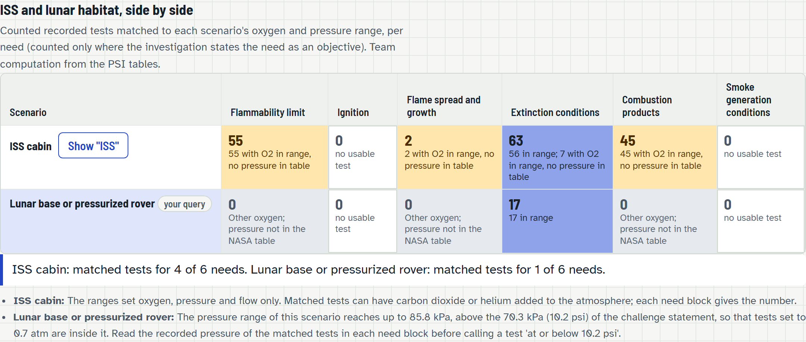
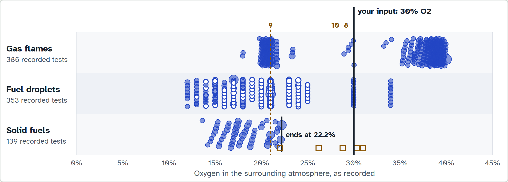

# Fire Evidence Explorer (NASA_RAPID)

Fire Evidence Explorer is a web page: you describe a crewed environment, and it shows which of NASA's microgravity fire investigations come closest, what their recorded tests can say about six fire-safety information needs, and where the evidence stops.

**Live page:** https://choidol0208.github.io/NASA_RAPID/

**Demo links:** [Lunar habitat, cotton fabric](https://choidol0208.github.io/NASA_RAPID/?q=lunar%20habitat%20cotton%20fabric) · [Lunar habitat](https://choidol0208.github.io/NASA_RAPID/?q=lunar%20habitat) · [ISS cabin](https://choidol0208.github.io/NASA_RAPID/?q=ISS) · [How it works](https://choidol0208.github.io/NASA_RAPID/how.html)

**Slides:** [docs/submission/slides.pdf](docs/submission/slides.pdf) (seven slides, a draft built by the pm AI session for the team to revise; source and build script in `docs/submission/deck/`)

**Start here:** open the "Lunar habitat, cotton fabric" demo, then the tab "What was found" (what NASA's documents report per question, then "ISS and lunar habitat, side by side") and the tab "Where the evidence stops". For the lunar habitat (30% oxygen or more and at or below 70.3 kPa), PSI has no counted test.

Built during the 2026 NASA Space Apps Challenge (Seoul, 14–15 November 2026) for the challenge *Flame in Freefall: SI-Powered Fire Safety Insights from Microgravity Combustion Data*. The data is NASA's Physical Sciences Informatics (PSI) archive: 24 combustion investigations.

Team: RAPID

It is a research exploration tool. It is not operational fire-safety guidance, and it is not endorsed by NASA. Scores, rankings and counts are the team's computation, not NASA's conclusions. Nothing on the page predicts what happens under conditions that were not tested.

*Most of this repository was written with an AI assistant (Claude Code). Each generated file says so at the top. `compliance/AI_USAGE_LOG.md` lists every use; see "How AI was used" below.*

## Screenshots

The images are screenshots of the page, taken with `web/capture_media.mjs` from the page built at the 19:00 freeze on 14 November. They were taken before scoring config 1.5.1 and before the page shell of 15 November (top bar, tabs, the method on `how.html`), so the layout, the order and the scores of the result cards in them can differ from the page now; the top three under config 1.5.2 are under "Ranking tests" below.

The lunar habitat query: how the input was read, and the closest investigations.


The ISS cabin and the lunar habitat side by side: counted recorded tests per need.



Where the evidence stops: every recorded test on the oxygen axis, by kind of fuel, with the input at 30% oxygen.



A short animation, from the ISS query to the lunar habitat query: [`web/media/demo_iss_to_lunar.gif`](web/media/demo_iss_to_lunar.gif) (2.4 MB). It was recorded on 14 November, before scoring config 1.5.1 and before the page shell, so it shows the old layout, and its result cards can show an earlier order and earlier scores.

## What you can do on the page

1. Type what you are building and where, for example "lunar habitat cotton fabric", or press one of six presets. Every value you left out is filled in and shown with where it came from. Without a material, the page warns that the fuel is not compared and asks for one.
2. Read the summary tiles, then move through five tabs: "Closest investigations", "What was found", "Where the data are", "Where the evidence stops", "All investigations".
3. See the three closest of the 24 PSI investigations, with the team's score, the match on each dimension and the largest gap; the source links and the longer notes open behind "Details and sources" on each card.
4. Per fire-safety question, read what NASA's documents and the investigators' papers report (quoted, with the numbers as printed), then whether the recorded tests hold the conditions and the outcome the question asks for, where the data are, and where the recorded tests stop on the oxygen and pressure axes.
5. Download the matched tests (CSV), the evidence package (JSON) and the quoted results (CSV), and share a query with "Copy link" (`?q=...`). The method is on its own page, "How it works" (`how.html`).

## What is implemented today

Checked on 15 November 2026 at about 16:15 KST against the page built from commit `362f010` in a scratch folder (`python3 web/build.py`: `built 62 files`): the section headings of the built `index.html` and `how.html`, `web/SHELL.md` and the data files the page loads. The live site was not opened for this check.

- The shell (`web/SHELL.md`): a sticky top bar with the search, "Copy link", "How it works" and "Source code"; after a query, a row of summary tiles ("At a glance") and five tabs; a footer with the notices and the build stamp.
- A query box with six presets: ISS cabin, Lunar habitat, Lunar habitat cotton fabric, Smoke detection on the ISS, Spacesuit, Mars base. `?q=` opens the page with a query.
- "How your input was read": each value, marked as typed by you, taken from a preset, or a default. A table "Requirements read from your question" checks each condition against each result and says what the check rests on ("met", "documented", "near", "not met", "unverified").
- Tab "Closest investigations", "Closest NASA investigations": the top three with the team's score (0–100), similarity per dimension, the reason, the largest gap and a confidence label. Behind "Details and sources" on each card: the source links, a summary of PSI's file listing for that investigation, and, for the "ISS", "lunar habitat", "spacesuit" and "Mars base" queries, a "Weight check" line on how stable the rank is when the team's weights are varied (sampled on config 1.5.2).
- Tab "What was found", first: "What NASA's experiments and documents report, question by question" (ui role, `web/results_first.py`), for the ISS cabin, the lunar habitat, the spacesuit and the Mars base. Per question, a headline of counts, three quoted results and the rest behind "Show all", each with its printed values, the team's group and its source, and a CSV of every quoted result. See "Results first" below.
- Tab "What was found", then: "What to consider, and what the recorded tests say": six needs against the ranked investigations, one status per cell from the data pipeline, and the ISS cabin and the lunar habitat side by side.
- "Recorded tests in the scenario range", "What is known, need by need" (fixed sentences built by code, no language model), "What NASA's recorded tests showed" and "Criteria in NASA documents".
- Tab "Where the data are", "Where the data are: in NASA's tables, in the archive, or no record": the three piles for each question (see "What the three piles claim" below), and for the ISS cabin and the lunar habitat the files of each test inside the ranges.
- Tab "Where the evidence stops": recorded tests on the oxygen axis by kind of fuel, a grid of recorded tests by oxygen and pressure, and what PSI does not contain for the chosen environment.
- Tab "All investigations", "All 24 investigations for this input": the full ranking.
- Downloads: the matched tests (CSV), the evidence package (JSON), all recorded tests (CSV), every quoted result (CSV).
- The method page `how.html` ("How it works" in the top bar): "How AI is used here, and how it was checked" (the counts for the model-written sentences, a diagnostic of whether the NASA tables could support an outcome model, and the sensitivity of the ranking to the team's weights) and "How the score works".
- The video side pilot appears as a note on the BASS-II result.

The page is static: two pages of fixed files. No language model runs in them, and they need no server, account or API key.

## What the three piles claim

*Written with an AI assistant (Claude Code). Counts are the team's computation from NASA PSI's file listing of 14 November 2026 and PSI's tables, not NASA's conclusions.*

1. **The idea.** PSI lists 60,866 files (13.47 TB) for the 24 combustion investigations; its experimental tables are 22 files of 0.2 MB, and the team's 1,824 tests come from 14 of them. Instead of processing the archive, code starts from a question and follows NASA's own test identifiers to the files. The page section "Where the data are" shows three piles per question.
2. **Pile 1, "In NASA's tables":** the tests recorded inside an environment's oxygen and pressure ranges, and what the tables hold for them.
3. **Pile 2, "In the archive, not in a table":** a test is recorded, but a value the question needs is not in a table. The pile lists the file groups that name the test, with their files and bytes and which files were opened. A listed group is not shown to hold the value.
4. **Pile 3, "No record in PSI (listing of 14 November 2026)":** printed on three grounds only, each with its source: a value common to every mapped table (gravity), every counted test outside by a recorded value, or a quoted sentence about a whole investigation.
5. **What the numbers are.** Files and bytes come from PSI's listing. For the lunar habitat, 398 files (104.4 GB, 0.77% of the bytes) carry the identifier or test number of one of the 26 tests inside the ranges; 316 of them are not archives or video recordings (86.9 MB). Of the 398, two labels agree for 336, 47 carry one label, and for 15 the labels name different tests (`data/pipeline/file_links_summary.json`). By name, 12,934 listed files carry the identifier of one test, 30,634 that of a test day or session, and 17,298 none (`raw_layers_summary.json`). The member lists of 12,600 of the 12,689 zip archives were read by range request (2.05 GB fetched; `archive_summary_totals.json`). Of the 2,623 video files, 662 are tied to one test by two labels that agree (`video/data/video_links_summary.json`).
6. **Values of a test** appear only where a file was read. They are shown as the file writes them and labelled "read from NASA's file, not adopted, not counted". Counted tests stay P1 133, P2 0, P3 2, S1 298, D1 122, D2 0.
7. **Not claimed:** that the archive was analysed or indexed as a whole; that a file naming a test holds the value; that "not found in the files opened" means absent from the archive; that pile 3 says what NASA tested; that the reading order is NASA's priority.
8. **Limits.** A research exploration tool, not safety guidance. Nothing here predicts an untested condition. The 17 counted tests inside the lunar-habitat ranges are fuel droplets in microgravity at 71.2 to 72.4 kPa. At 30% oxygen or more and at or below 70.3 kPa, there is no counted test.
9. **Who checked.** AI sessions wrote the code. A second AI session of another role recounted the chain with its own code (`validation/raw_chain_recount.py`): 62 of 71 expected values reproduce; the 9 others all concern how video files are tied to tests and are listed in `validation/raw_chain_recount_report.md`. Reviewed by a person: 0. Review by combustion researchers is a next step.
10. **Where it lives.** Design: `docs/raw_data_design/design.md`. Sentences and their grounds: `docs/raw_data_design/pile_wording.md`. Claims with numbers and files: `docs/raw_data_design/claims.md`.

## Results first

*Added by the data role on 15 November 2026 (`pipeline/results.py`, `pipeline/spec/results.json`; AI-generated code). Counts are from `data/pipeline/results_summary.json`.*

The pipeline also arranges what NASA's experiments found, as published, question by question:

- `data/pipeline/results_by_need.json`: one block for each of the 6 environments and 6 needs (36 blocks). Each block lists the quoted results for the need, the criteria (as quotations), the steps of NASA's fire-safety process, the recorded tests, and the three piles.
- `data/pipeline/results_flat.csv`: the same results with their printed values, one row per value (779 rows), for filtering in a spreadsheet.
- `data/pipeline/results_summary.json`: the counts. 212 published results from 46 documents; 168 of them print values (735 printed value rows) and 44 do not. 123 of the 212 come from the 66 results (reference items) added on 15 November from 21 NTRS documents (NASA Technical Reports Server); 89 were there before. Per need: P1 35, P2 8, P3 41, S1 23, D1 18, D2 47, and 45 tagged for all questions.

The results are quotations of NASA documents and of the investigators' papers, with the numbers exactly as printed, and each carries its document, place and access. Where a result is labelled as computed by the authors, as a simulation or as preliminary, its text begins with that label (89 results added before 15 November carry no such label). Their order is a fixed rule with no weights: first the results whose own words state an oxygen and a pressure inside the environment's ranges, then those that state at least one condition inside and none outside, then the others. The team computes nothing from the printed values and compares nothing with a criterion, and a result is not carried from the condition where it was stated to another one. `pipeline/check.py` checks every quote, value and count of these files against the reference list (checks U1 to U5). The results were read by AI agents; reviewed by a person: 0.

- `data/pipeline/results_top.json` and `results_top.csv` (`pipeline/results_top.py`): for each of the 36 blocks, the five results to show first (180 in all), by a fixed rule with no weights (the question's own results; condition group, then measured before computed or preliminary, then PSI investigations of the catalog before related NASA experiments, then printed values first, then item id; at most two per document). Check U6 rebuilds the choice with its own code. It is a data deliverable; the page does not print it today.

Where they are used: on the page, the section "What NASA's experiments and documents report, question by question" (first in the tab "What was found") prints `results_by_need.json` per question, with `results_flat.csv` as the download. The answer files the page loads (`data/pipeline/answers/`) carry the field `results_first` that points to these blocks. Details: `pipeline/README.md`, "Results first" and "Five to show first".

## How it is built

The team worked in four Claude Code sessions, one per role: pm, data, ui and catalog. Each part below names its folder and its role.

**Data pipeline** (`pipeline/`, outputs in `data/pipeline/`; data role). The data role's AI session (Claude Code), directed by the team, drafted six fire-safety questions from published documents (the reference list `pipeline/spec/references.json`, 82 entries on 15 November), each with the variables a test must record. The pipeline maps 14 of the 22 PSI experimental tables to standard variables, giving 1,824 test rows. It links a test to a need only when the investigation states that need as an objective. `pipeline/check.py` recomputes every output with separate code. Details: `pipeline/README.md`.

**Ranking** (`scoring/`, `validation/`, `data/catalog/`; catalog role). A catalog of the 24 investigations and their 41 test configurations, extracted from the PSI records and tables by an AI assistant. A rule-based scorer compares the input with each configuration on up to seven dimensions (oxygen, pressure, flow, fuel, sample shape, research purpose, diluent gas), with weights that depend on the kind of question (scoring config 1.5.2; a query that names no material carries the warning that the fuel is not compared). Code computes every score; a language model never produces or changes one. The page runs a JavaScript port of the same scorer, and a check confirms that both give the same results. Method: `scoring/METHOD.md`.

**AI layer** (`ai/`, outputs in `data/insights/`; pm role). Code builds the scenario text, the gaps, the counts, the quotes and the evidence map from the PSI files and the pipeline outputs. One local language model wrote short summary sentences for the investigation cards before publishing; code gates checked each sentence. Details: the section "AI layer" below.

**Page** (`web/`; ui role, shell by the pm role). Plain HTML, CSS and JavaScript: the dashboard `index.html` and the method page `how.html`, with the shell (`web/shell.css`, `web/shell.js`, `web/SHELL.md`). `web/build.py` copies the pages and the data files they read into `web/dist/`. A GitHub Actions workflow (`.github/workflows/pages.yml`) runs the ranking unit tests, the validation scenarios, the integration check and the JavaScript/Python parity check, builds the page and deploys it to GitHub Pages. The AI-layer, pipeline and video checks are run by hand (see "How to run it"). Details: `web/README.md`.

**Video side pilot** (`video/`; pm role). For 19 BASS-II clips (PSI-25), a reader copies the numbers NASA's video shows on screen (FUEL, AIR, FAN, RAD and a clock) into one row per second. It is a transcription of NASA's display, not a NASA data file and not a measurement. Output: `video/data/team_transcription_bass2_onscreen_readings/`. Details: `video/README.md`.

## Assistant

*AI-generated section (Claude Code, pm role, 15 November 2026). The assistant's code in `ai/assistant/` was written with an AI assistant (Claude); every file says so in its first line.*

The assistant answers under the page's one input, above the dashboard. You type what you are building and where, or a question, in your own words and in any language (it answers in English); the same text updates the dashboard at once, and a box for follow-up questions appears with the first answer. It covers the four points of the challenge's Objectives:

- the **investigations most relevant** to a crewed environment: spacecraft, station, lunar or Martian base, pressurized rover or spacesuit;
- the **data that support predictive modelling**, and where they are: in NASA's tables, in the archive but unprocessed, or with no record in PSI;
- the **research behind fire-safety equipment and controls**: detection, suppression, material selection and ventilation;
- what the records say about **applications on Earth**.

Each answer has numbered citations that open their source. Beside it are the panels that fit the question: ranking, counts per fire-safety question, the three piles, a test table to download, criteria, the files of a test, quoted NASA sentences, and (added 15 November) what NASA's documents report for the question: quoted results of the experiments with their printed values, in the data role's fixed order by stated conditions. The dashboard below is driven to the same request.

### How one turn works

The model is used in several small steps, each with its own narrow prompt and JSON schema, and code sits between them. The page shows each step as it runs.

1. **Understand** (model and code). The message becomes a structured request: what is wanted (a closed list of ten intents), the environment, the material, the fire-safety questions and any investigations named. The model reads it twice, with two seeds, and the existing rule parser (`scoring.scorer.interpret`) reads it a third time. A field is taken where the readings agree. Where they conflict, or a needed value is missing, the assistant asks one clarifying question or states the assumption it makes.
2. **Plan** (code). A fixed table picks the lookup tools from the request; the model does not choose them.
3. **Look up** (code). Deterministic tools read the team's files and return numbered facts. Each fact has a sentence built from a template, its numbers, its source file and a link.
4. **Write** (model). A short answer built only from the facts given. Every sentence names the facts it rests on.
5. **Check** (code, then model). Code gates test every sentence: it must cite a fact, every number must appear in the cited facts, quotations must be verbatim, and it must hold no safety verdict, advice, prediction or "validated". Then a second model pass, with a fresh prompt that sees only the sentence and its cited facts, answers "does this follow from these facts alone?". A failing sentence is removed, or the answer is repaired once. A repair is made only when a model call is left for the checker after it: **no model sentence is shown without having passed both the code gates and the model checker**. When the checker cannot run or its reply is invalid, the answer is put together by team code from the facts, and a notice says why. If nothing trustworthy remains, the same template answer is shown.
6. **Deliver.** The answer, its citations, the panels, the reading of the request as editable chips, and two or three follow-up questions.

A turn makes **at most four model calls**: two readings, write and check; or one reading, write, repair and check when the second reading was not needed. A preset button or a repeated request is answered from cache or by template, with no model call. The conversation is carried as the structured request, not as raw chat history.

| Technique | What it guards against |
|---|---|
| Structured reading into a closed vocabulary (JSON schema) | free-text misreading; values the tools do not know |
| Repeated reading (two model readings and the rule parser, field by field) | one unstable reading |
| Numbers kept only if they are in the message; code converts units | invented or miscomputed numbers |
| One clarifying question, or a stated assumption | answering a different question |
| Tools chosen by a fixed table | the model picking what to look up |
| Facts only from the tools; fact ids as a schema enum | facts from model memory; invented citations |
| Small contexts: only this turn's facts, structured state | distraction, long prompts |
| Code gates on every sentence | unsupported numbers, verdicts, advice, invented names |
| One repair with the gate failures as feedback | fixable slips |
| A model checker with a fresh prompt | paraphrase that goes beyond the facts |
| A template answer from the facts as the fallback | a turn with nothing trustworthy to show |

The contract is `ai/assistant/DESIGN.md`. A reader's version is `docs/assistant/README.md`, and the published methods it draws on are in `docs/assistant/techniques.md`.

### Install and run

```
./install.sh --check      # report what is present and what would be done; downloads nothing
./install.sh              # check Python 3.10+, install Ollama if missing, download the model, build, self-test
./run.sh                  # open http://127.0.0.1:8765/ with the assistant
./run.sh --no-model       # the same with rule-based answers only, no language model
```

The install needs Python 3.10 or newer, with the standard library only (no pip packages), and [Ollama](https://ollama.com/download). The model is **OpenAI gpt-oss:20b** (Apache-2.0), run locally through Ollama. It is about 13 GB to download, the size `ollama list` shows on the build machine. `install.sh` downloads it as part of the install: it says the size, asks once (Enter means yes; `--yes` skips the question) and then checks the installed digest against `ai/config.py`. If Ollama is missing, it offers to install it by Ollama's official method (Homebrew on macOS, the install script on Linux); `--install-ollama` skips that question. Without the model, `./install.sh --no-model` and `./run.sh --no-model` give the rule-based assistant.

Measured on the build machine (Apple M4 Pro, 48 GB): the model ran at 50.1 to 51.0 tokens per second (`ai/runs/smoke.jsonl`, 14 November). After one assistant turn, Ollama reported the loaded model at 12.7 GB, all of it on the GPU, with a context of 16,384 tokens (`GET /api/ps`, 15 November). The evaluation records the same reading as `loaded_model` in `data/insights/assistant_eval.json`. With 16 GB of memory or less the model may not fit beside the system; that is a rule of thumb, not a test. The server listens on 127.0.0.1 only and sends nothing off the machine. Conversations are not stored in the repository; run-time logs go to the git-ignored `ai/assistant/_runtime/`.

**The public page** runs no language model. The page build (`python3 web/build.py`) includes the assistant in recorded mode: it replays conversations recorded with the local model on 15 November, each marked as recorded (`data/insights/assistant_recorded.json`, written by `python3 -m ai.assistant.record`). Of the ten scripted conversations, six are replayed. An AI session read every model sentence of the recording; four conversations were re-recorded once and still had a sentence that went beyond its facts or an answer that dropped part of the request, so they are left out and named with the reason under `left_out` in the file. Recorded mode was checked with no assistant server behind the page, on a copy of `web/dist` served by `python3 -m http.server`. The deployed GitHub Pages site was not checked from this session.

Screens of recorded conversations (taken in that recorded mode, 15 November): [closest investigations for a Mars base, after one clarifying question](docs/assistant/screens/1_closest_investigations_mars_base.jpg), [the raw files of one test](docs/assistant/screens/2_raw_files_of_one_test.jpg), [research behind a smoke detector, asked in Korean](docs/assistant/screens/3_research_behind_smoke_detection.jpg), [a declined request for a prediction](docs/assistant/screens/4_declined_prediction.jpg).

### What is measured

`python3 -m ai.assistant.evaluate` runs a fixed set of 74 questions (`ai/assistant/eval/questions.json`) through the pipeline's own entry point. An AI session wrote the questions and their expected readings before any model run; no person has read them yet. The set covers each Objective point, comparisons, follow-ups, vague requests that need a clarifying question, requests for a safety verdict or a prediction that must be declined, questions the files cannot answer, 17 questions in Korean, Japanese or Spanish, and 4 that hide instructions in quoted text. Five arms are compared:

- `single_call`: one model call that gets the facts and answers, with no repeated reading and no checks;
- `full`: the whole pipeline;
- `no_repeat`, `no_gates`, `no_checker`: the full pipeline with one technique switched off.

Results go to `data/insights/assistant_eval.json` and `docs/assistant/evaluation.md`.

<!-- assistant-eval-table:start -->
**Results: not yet measured.** This table is filled by `python3 -m ai.assistant.evaluate --write-readme` after the evaluation run. No number is written here by hand.

| Measure | `single_call` | `full` | `no_repeat` | `no_gates` | `no_checker` |
|---|---|---|---|---|---|
| (to be filled by the evaluation) | | | | | |
<!-- assistant-eval-table:end -->

How to read the results: the question set is small and was written by an AI session of the team, so it is not a benchmark. The code gates that measure the answers are also part of the full pipeline. The checker is the same model as the writer, so its verdicts are not independent.

### Limits

- It gives **no safety verdict** and **no estimate at conditions the recorded tests did not reach**. When asked for either, it says so and shows what the files hold instead.
- It answers only from the team's files. When they do not hold an answer, it says so and names what would be needed.
- Text from NASA records and from the user is treated as data, never as instructions.
- Answers are in English. Requests in other languages are read by the model; the rule parser knows only English and some Korean.
- The only model is OpenAI gpt-oss:20b (Apache-2.0) through Ollama, called only through `ai/llm.py` with its allowlist and digest check.
- It is a research exploration tool, not safety guidance. Every model-written answer is labelled as written by a local language model from the facts shown and checked by code and by a second model pass. Checked by code and AI sessions; reviewed by a person: none.

## How to run it

Needs Python 3 (tried with 3.13.5). The page build, the scorer and the pipeline check use only the Python standard library. Other needs are named at each step. The results below were measured on 15 November 2026 at about 16:15 KST, at commit `362f010` (the build, the pipeline check, the AI tests and checks and the validation run on copies in a scratch folder, so that nothing in the repository was written).

### Build and open the page

```
python3 web/build.py
cd web/dist && python3 -m http.server 8000
```

Then open http://localhost:8000/?q=lunar%20habitat%20cotton%20fabric (the method page is http://localhost:8000/how.html). The build printed `built 62 files` (with `assistant widget: not included`, because `data/insights/assistant_recorded.json` is not committed yet).

### Pipeline checks

```
python3 pipeline/check.py
```

This recomputes every output in `data/pipeline/` from the raw tables and the spec files, and rewrites `data/pipeline/validation_report.json`. To leave the repository unchanged, check a copy:

```
cp -R data/pipeline /tmp/pipeline_copy
python3 pipeline/check.py --data /tmp/pipeline_copy
```

Result on a copy: `96 checks: 91 PASS, 0 FAIL, 5 SKIP`. The five skipped checks (N1, N2, O4, O5, P3) recount the raw-data inventory, the raw values, the raw-column spec and the name ties, which need the saved PSI listings in `data/psi/file_listings/`. That folder is not in the repository. The report in the repository, `data/pipeline/validation_report.json`, written by the data role with the listings, records 96 checks, 96 PASS. `python3 pipeline/raw_inventory.py --refresh` fetches the listings from PSI.

To rebuild the pipeline outputs (needs pandas; this downloads from PSI and rewrites `data/psi/` and `data/pipeline/`; not run for this README):

```
python3 scripts/fetch_psi.py
python3 pipeline/run.py
```

### Ranking tests

```
python3 -m scoring.scorer "lunar habitat"
python3 -m unittest scoring.test_scorer
python3 web/parity_check.py
python3 web/check_integration.py
```

Results: `Ran 79 tests ... OK`; `parity: 106/106 queries identical` (needs Node.js 18 or later; tried with v25.2.1); `11 queries, 33 results checked, 0 broken joins`.

The demo top threes under scoring config 1.5.2, as `scoring.scorer.rank` returns them (each score orders the investigations for its own query only; scores of different queries are never compared, and the environments are compared by their counts of tests):

- `lunar habitat cotton fabric`: SAFFIRE-II (75.0) and SAFFIRE-I (74.5), both cotton-fiberglass (SIBAL) fabric, and ACME-BRE (62.6), a gas burner, third by the rule that one place goes to a result tested at the query's oxygen (`scoring/METHOD.md` 1.5).
- `lunar habitat`: FLEX (75.2), ACME-CFI-G (71.6), ACME-BRE (73.6). No material is named, so the fuel is not compared and the page says so: fuel droplets and gas burners, the ranking without a fuel comparison.
- `ISS`: BASS-II (93.4), SAFFIRE-I (92.1), SAFFIRE-II (92.1). No material is named here either.

Results within 3 points of the best remaining score are ordered by recorded share, then by evidence factor, then by score (`scoring/METHOD.md` 1.5, "Selection"); so ACME-CFI-G (evidence factor 0.97) is placed above ACME-BRE (0.95), both with a recorded share of 0.67.

The scenario, stability and sensitivity checks rewrite `validation/report.md` (not run for this README):

```
python3 validation/run_validation.py
```

### AI layer build and tests

```
python3 -m unittest discover -s ai -p "test_*.py"
python3 ai/check_all.py
```

Result of the tests, run with `AI_NO_MODEL_CALLS=1`: `Ran 363 tests ... OK` (the AI layer's tests in `ai/` and the assistant's in `ai/assistant/`). No test calls a model. `ai/check_all.py` only reads; it checks everything in `data/insights/`.

Result of `ai/check_all.py` at commit `362f010`: `PASS: 0 hard failure(s); 2 file(s) not built yet; 0 report-only lint hit(s)`. The two files not built yet are the assistant's `data/insights/assistant_eval.json` and `assistant_recorded.json`.

The build rewrites every file in `data/insights/`, with no model call (needs NumPy, pandas and scikit-learn; not run for this README):

```
python3 ai/build_all.py
```

### Video reader tests

```
python3 video/test_read_overlay.py
python3 video/read_overlay.py --settings video/settings/bass2.json --list
```

Results: `Ran 10 tests ... OK` (needs NumPy and Pillow); `--list` printed the 19 clips. The tests run without the videos.

Reading the clips needs the 19 mp4 files from PSI, which are not in the repository, and `ffmpeg` and `ffprobe` (not run for this README):

```
python3 video/read_overlay.py --settings video/settings/bass2.json --clips <folder with the mp4 files> --out <folder>
```

## Data and licence

Data: NASA PSI Data Repository, https://psi.nasa.gov/ (records are CC0-1.0 where a license is stated; see `compliance/SOURCES.md`). PSI asks that each investigation be cited by its DOI; the DOIs are in `data/psi/manifest.json`.

The repository holds what the page needs: the 24 PSI records, the 22 experimental tables and the manifest in `data/psi/`. The BASS-II video clips are not in the repository. Fonts, libraries and documents used are listed with their licences in `compliance/SOURCES.md`.

## How AI was used

- Code, documents and data processing were written with Claude Code (Anthropic) in four working sessions, one per team role, under the team's direction. Each generated file says so at the top.
- In the product, one local model, OpenAI gpt-oss:20b (Apache-2.0, run through Ollama), wrote short summary sentences for the investigation cards before publishing. The page never calls a model. No number, score or count comes from a model.
- Code gates checked every model sentence; a second AI session then read them. Of 70 sentences, 33 are shown, each labelled "AI-generated" with the NASA sentences it rests on. Reviewed by a second AI session: 61. Reviewed by a person: 0.
- The same second AI session (data role) read every code-written sentence and every quoted NASA sentence on the page: 226 of 226 code-written sentences marked as worded correctly, and of 102 quoted NASA sentences 92 marked relevant and 10 not relevant (not shown) (`ai/review/review_sheet.csv`, `data/insights/quality.json`). Reviewed by a person: 0.
- The published results of "Results first" were collected and quoted by AI agents of the data role; for the 66 added on 15 November, a second AI agent re-found each quote and number in the PDF text (`compliance/AI_USAGE_LOG.md`, row of 11/15 12:45).
- The full record is `compliance/AI_USAGE_LOG.md`. On the method page `how.html`, the block "How AI is used here, and how it was checked" shows the counts (`data/insights/quality.json`).

## Known limits

Data and pipeline (from `pipeline/README.md`):

- Only PSI's experimental tables are mapped into tests: 14 of the 22 tables. The other 8 are not one row per test (for example, one row per test day). Raw files are classified by name and only a few were read; values read from them enter no count. Published results are quoted, not mapped.
- A "test" is one row of a NASA table.
- The six needs are the team's construction (an AI draft) from published documents, not a NASA list or standard. Five of the six are limited to solid fuels.
- 408 of the 1,824 test rows count for at least one need. They come from four investigations (PSI-25, 69, 98, 99).
- Ignition and smoke particle size have no counted test: no mapped column holds those outcomes.
- The BASS-II and Saffire tables have no pressure column. Pressure is documented for each investigation as a whole (about 1 atm), not for each test.
- The Saffire oxygen value is what the ISS reported about one day before the tests, not a reading at ignition.
- The ISS ranges are the team's bins, not an ISS operating range.
- Lunar habitat: the 17 counted tests in its oxygen range are FLEX droplet tests recorded at 71.2 to 72.4 kPa, 1 to 2 kPa above 70.3 kPa (10.2 psi). No counted test was recorded at 30% oxygen or more and at or below 70.3 kPa.
- Every test in the PSI tables used here was run in microgravity. The challenge statement suggests that results at the two ends of the gravity scale could bound what occurs at intermediate gravity levels. The page does not treat them as bounds: in NASA drop-tower tests of three materials (Olson and Ferkul 2012, Table I), the oxygen limits at lunar gravity were lower than at both 0 g and 1 g, and at Martian gravity lower for two of the three; those 5.18 s drops used extinction criteria that differ from the 1 g test.

Ranking (from `scoring/PARAMETER_REVIEW.md`, `scoring/METHOD.md` and, for config 1.5.2, `validation/report.md` of 15 November, 15:20):

- A query that names no material is ranked without a fuel comparison; the page warns about it and asks for a material (review item B3, the human lead's decision). The review's other decisions (B1, B2, B4, B5) are in `scoring/METHOD.md` 1.2, 1.5, 1.7 and 1.8.

- The weights and scales are the team's choices. A combustion textbook (Turns 2012) supports the direction of several rules, not their sizes.
- Each prevention weight was halved and raised by half on four demo queries (ISS, lunar habitat, and each with cotton fabric): 44 of 48 variants keep the same top three in the same order, 1 keeps the same three in another order, and rank 1 changes in 3.
- Each other value was halved and raised by half on the same queries: of 136 runs, 124 keep the same top three in the same order, 3 keep the same three in another order, and rank 1 changes in 5.
- The ISS query keeps its top three in all of these runs. The lunar habitat query changes in 5: with the oxygen weight halved or the flow weight raised (another investigation enters the top three; rank 1 changes with the oxygen weight halved), and with the tie margin halved, the flow configuration table raised or the data-availability table raised (the same three in another order; rank 1 changes with the data-availability table raised). The other changes come from the two cotton-fabric queries.
- A configuration whose record gives no atmosphere is scored at an assumed 21% oxygen and 101.3 kPa. It can outscore a recorded near match; the page labels it with medium confidence.
- Within 3 points of the best remaining score, results are ordered by recorded share, then by evidence factor, then by score, so a lower score can be placed above a higher one. At low scores, 3 points is a large share.
- Catalog values were extracted from the PSI records by an AI assistant and are labelled "AI-extracted" on the page.

Video side pilot (from `video/README.md`):

- 19 BASS-II clips only; nothing is said about the other 277 clips of PSI-25. Not tried on any other experiment.
- An AI assistant compared 186 frames (about 750 values) with the picture and found none wrong. From the random frames alone, fewer than about 1 value in 100 should be wrong.
- It gives no flame-out time, ignition time, burn duration, or flow speed at blowoff or extinction. An automatic flame signal from picture brightness failed its check and was removed.
- RAD is an uncalibrated reading, not a heat flux. AIR 0 does not mean still air. A flow speed derived from FAN is a calibration estimate, off by about 30% where it could be tested.
- The download path of `--fetch` has not been run. A watcher for new PSI data is a design only.

## What is next

- Review by combustion researchers: the eight questions at the end of `scoring/PARAMETER_REVIEW.md`, and the six needs in `pipeline/spec/needs.json`.
- Compare the catalog values behind the demo rankings with the NASA rows listed in `validation/verification_sheet.csv`.
- Map the per-sample pressure column of the Saffire raw data in PSI, which the pipeline does not read yet.
- Add test-level records from combustion tests at lunar gravity when such records exist in PSI.
- Show the five first results per question of `data/pipeline/results_top.json` on the page.

## Repository map

| Path | Content | Role |
|---|---|---|
| `web/` | The page, its build, the scorer's JavaScript port and the checks. `web/media/` holds the screenshots | ui (scorer port: catalog) |
| `pipeline/` | Spec-driven pipeline from the PSI tables to standard variables and fire-safety information needs | data |
| `data/psi/` | PSI records and experimental tables as downloaded, and the manifest with the DOIs | data |
| `data/pipeline/` | Pipeline outputs: one row per test, capability matrix, tests per need, evidence packages, answer files, the raw-data chain and the quoted results per need ("Results first") | data |
| `data/catalog/` | Catalog of the 24 investigations and 41 test configurations | catalog |
| `scoring/`, `validation/` | Rule-based ranking, its method, and its test scenarios and sensitivity checks | catalog |
| `ai/`, `data/insights/` | AI layer: code-built text, card summaries, evidence map, diagnostics | pm |
| `video/` | Video side pilot: on-screen readings of 19 BASS-II clips | pm |
| `docs/submission/` | Drafts of the submission text and the slide outline; the seven-slide deck (`slides.pdf`) | pm |
| `compliance/` | `SOURCES.md` (every source and licence) and `AI_USAGE_LOG.md` | all roles, append only |
| `coord/` | How the four working sessions coordinate; `coord/roles.json` lists each role's branch and paths | pm |
| `contracts/` | Which file is produced by whom and read by whom | pm |
| `scripts/` | Fetching PSI, profiling the tables, building the catalog, coordination helper | data, catalog, pm |
| `reports/` | Spot-check sheet of raw cells to compare with the NASA pages | data |
| `presentation/` | One slide on the ranking | ui |
| `AGENTS.md` | The rules the AI sessions work under | pm |

## Licence

Code and documents in this repository: Apache-2.0, see `LICENSE`. NASA PSI data: see "Data and licence" above.

## AI layer (`ai/`)

All code in `ai/` is AI-generated: it was written with an AI assistant (Claude Code) during the hackathon, and every file says so in its first line. Every data file it writes to `data/insights/` carries a disclosure block (`_meta`: which script built it, that the code was written with an AI assistant, and which language model, if any, ran at build time); the same blocks are collected in `data/insights/_meta.json`.

The product uses one language model: OpenAI **gpt-oss:20b** (Apache-2.0), run locally through Ollama before publishing. It writes at most three summary sentences per card (`data/insights/cards.json`) and nothing else; the public site never calls a model. Every model call goes through `ai/llm.py`, which refuses any other model before opening a network connection, checks the installed model digest, validates the reply against a JSON schema and logs each call to `ai/runs/` (call logs, not product content; the model's thinking text is never stored). Scenario text, gaps, counts, quotes and the evidence map are built by code from the NASA PSI tables and records and the data role's pipeline outputs.

Rebuild everything with one command, with no model call:

```
python3 ai/build_all.py                                   # every step in order, then ai/check_all.py
python3 -m unittest discover -s ai -p "test_*.py"         # the tests
```

`ai/build_all.py` runs, in this order, `ai/evidence.py`, `ai/build_baseline.py`, `ai/evidence_map.py`, `ai/model_readiness.py`, `ai/robustness.py` (about a minute), `ai/apply_cards.py` (from the logged model output in `ai/runs/`), `ai/audit_catalog.py`, `ai/apply_review.py` and `ai/check_all.py`, sets `AI_NO_MODEL_CALLS=1` so that `ai/llm.py` refuses any model call, stops at the first failure and exits non-zero. The order matters: `ai/build_baseline.py` rewrites `cards.json` with the quoted cards, so the card and review steps must run after it. NumPy, pandas and scikit-learn (BSD-3-Clause) are needed for the readiness and robustness steps; everything else is the Python standard library.

| File | What it does | Language model |
|---|---|---|
| `ai/build_all.py` | Runs every build step in order, then `ai/check_all.py`; stops and exits non-zero on the first failure; checks that no run log in `ai/runs/` changed | none (forbids calls) |
| `ai/__init__.py` | Marks `ai/` as a package (`python3 -m ai.llm`, `ai.test_*`) | none |
| `ai/config.py` | The one allowed model, its digest and the call defaults | none |
| `ai/llm.py` | Model guard, JSON validation and call log; `python3 -m ai.llm --smoke` runs three test calls | gpt-oss:20b (only when called directly or by `ai/cards_llm.py`, `ai/apply_cards.py --repair`) |
| `ai/meta.py` | The AI-generation disclosure block and `write_json()` | none |
| `ai/resolve.py` | Resolves every source string used in `data/insights/` (`PSI-25.objective`, `doi:...`, `path#id`, `path#need/statement`) to the real text or row, or fails | none |
| `ai/evidence.py` | Splits the prose of the 24 PSI records into numbered sentences with exact character offsets; writes `data/insights/evidence.json` | none |
| `ai/templates.py` | The fixed wording of every code-built sentence (need statements, frames, gaps, result notes, quoted cards) | none |
| `ai/build_baseline.py` | Writes `data/insights/scenarios.json` (four scenarios: frame, one statement per need, gaps, result notes for the live ranking) from the pipeline CSVs and the data role's evidence packages, and the 24 quoted cards of `cards.json`; recounts every count and stops on any difference | none |
| `ai/evidence_map.py` | Writes `data/insights/evidence_map.json` for "Where the evidence stops": recorded tests on the oxygen axis per fuel lane, cited atmospheres, the team's ranges and the Saffire IV to VI samples as cited, uncounted marks | none |
| `ai/model_readiness.py` | Writes `data/insights/model_readiness.json`: for each outcome label of a NASA table, counts, ranges and, where a fixed rule allows it, grouped cross-validation of a simple model against the base rate; no fitted output is shipped | none |
| `ai/robustness.py` | Writes `data/insights/robustness.json`: how often each top result of the team's ranking stays first or among the first three when the team's weights are sampled (8,000 draws per run, seeds 42 and 43) | none |
| `ai/cards_llm.py` | Sends each record's numbered sentences to gpt-oss:20b and logs the raw candidate summaries in `ai/runs/` (prompts in `ai/prompts/`); never writes `data/insights/` | gpt-oss:20b |
| `ai/checks.py`, `ai/lint_patterns.py` | The code gates for model sentences (ids, verbatim quote, numbers, names, advice and prediction wording, misconception linter, length, sources, modality, hedges) and the checks for template text; quoted verbatim NASA text is not read by the wording gates, team and model text always is | none |
| `ai/apply_cards.py` | Gates the logged candidates, applies the reviewed removals of `ai/review/pm_prereview.json`, leaves out the quotes a reviewer marked `not_relevant`, writes `cards.json` with quotes taken by code and the review sheet `ai/review/review_sheet.csv` (built with the sheet's verdicts applied, so it lists what the page shows); without `--repair` it only reads the logs | none by default; gpt-oss:20b only with `--repair` |
| `ai/audit_catalog.py` | Traces every number of the catalog text the page shows to a NASA source; writes `data/insights/catalog_trace.json` | none |
| `ai/apply_review.py` | Applies the verdicts of `ai/review/review_sheet.csv` (removes sentences marked `not`, `partly` or modality `no`; leaves out quotes marked `not_relevant`; sets `reviewed_by`); rewrites the sheet from the cards as shown; writes `data/insights/quality.json` | none |
| `ai/check_all.py` | One check over everything in `data/insights/`: headers, disclosure blocks, append-only compliance files, evidence offsets, a second-path recount against `scenario_needs.csv` and a third path (evidence packages), every card and scenario statement re-gated, labels, sources, freshness, the review sheet against what the cards and scenarios show, `model_readiness.json` against a fresh build and `robustness.json` against `rank()` now | none |
| `ai/test_*.py` | Unit tests: `test_llm`, `test_evidence`, `test_checks`, `test_baseline`, `test_evidence_map`, `test_cards`, `test_review_quotes`, `test_model_readiness`, `test_robustness` | none |

`ai/review/README.md` explains the review sheet and how another session adds a reviewed removal to `ai/review/pm_prereview.json`. A review verdict never rewords anything: a model sentence or a NASA quote is shown or not shown. A template row marked `wording_issue` is fixed in the code that builds the sentence (`ai/templates.py`, `ai/build_baseline.py`); two `not_covered` lines of `pipeline/spec/needs.json` (the partial-gravity line and the monitoring-ranges line) are therefore built by code from the files they rest on instead of being copied as written (rule `not_covered_reworded:<item>`, review of 14 Nov).

The scenario text follows the data role's evidence packages (`data/pipeline/evidence/scenario_<id>.json`): their fixed sentences, the scenario caveat and the matched ranges are used as written and cited, and the counts are recounted from the pipeline files on every build. For the lunar habitat, the 17 matched droplet tests (at the 14:59 merge) are described as recorded at 30 to 34% oxygen and about 0.7 atm (71 to 72 kPa), 1 to 2 kPa above the 10.2 psi of the challenge statement; no counted test was recorded at 30% oxygen or more and at or below 10.2 psi (`coord/decisions.md`, 11/14 14:15).

Text quoted from a PSI record is shown with the label of the record field it came from (for example "Stated hypothesis:"), as what the record states, not as a measured result. Counts are recorded tests in NASA's open PSI experimental tables, the team's computation; they are not predictions, limits or safety verdicts.
